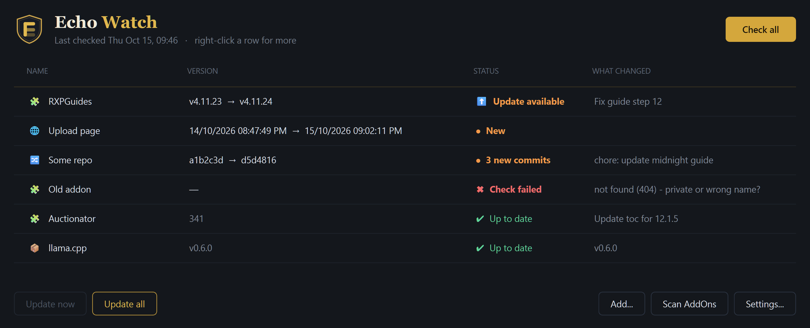

# Echo Watch



A small PyQt6 desktop app: press **Check all** once a day and see what changed.

- **WoW addons** - compares the version in your AddOns folder (read from the `.toc`) with the latest
  [Wago](https://addons.wago.io) release for the *forever* flavor. **Update now** downloads the zip,
  moves the old folder to a backup, and installs the new one.
- **WoW addons from GitHub** - same as above but the latest version and zip come from a repo's releases (e.g. `RestedXP/RXPGuides`), so addons that are not on Wago can still auto-update.
- **GitHub releases** - flags a new tag since you last marked it seen.
- **Web page text** - watch any page: give a URL and a regex for the text to track (for example `Upload times*(.+? [AP]M)`), and any change to it is flagged. With no pattern it flags any change to the page text, which is noisy on pages with ads.
- **GitHub commits** - shows the newest commit and how many are new since you last marked it seen.

- **Scan AddOns** - scans the AddOns folder saved in **Settings** (retail, classic or a beta client) and adds every addon Wago
  knows about is added automatically. It uses the `X-Wago-ID` from the `.toc` when present.
- **Update all** installs every outdated addon. A failed install is rolled back from the backup.
- **Check on launch** (Settings) runs the check as soon as the app opens.

Every item has a display name you can rename. First check of a release/commit item sets a silent
baseline; use **Mark seen** to clear a "New" flag.

## Run

```
pip install -r requirements.txt
python echo_watch.py        # or double-click run.bat
python echo_watch.py --check  # check immediately on launch
```

Config lives in `%LOCALAPPDATA%\EchoWatch\config.json`; addon backups in `...\EchoWatch\backups`.
Set the AddOns folder under **Settings...** (default is the WoW classic beta folder).

GitHub lookups use `GH_TOKEN`/`GITHUB_TOKEN` or `gh auth token` if available, otherwise the 60/hour
anonymous limit applies. `python smoke_test.py` checks the network sources.

Windows only for now. Wago's page layout is scraped, so it may need a fix if Wago changes it.
Addons are third-party software under their own licenses; Echo Watch only downloads what you
choose to watch.
